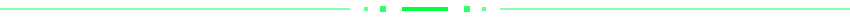
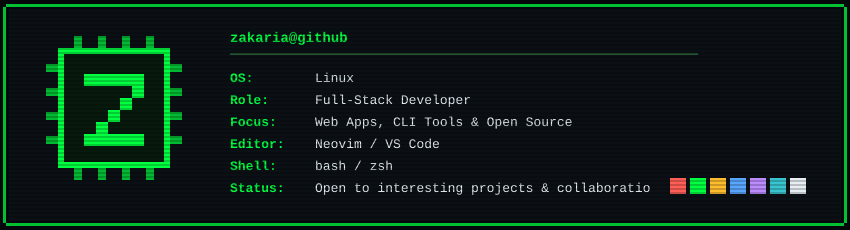

<!-- Approach 1: Custom Pixel-Art SVGs + Markdown -->

  

  

### `> whoami`

- Building fast, reliable web apps, developer tools, and creative software from the command line.
- Currently exploring systems programming, modern web architecture, and clean UI/UX.
- Always down to collaborate on open-source projects or talk shop about Linux & tooling.

  

  

### `> cat skills.json`

**Languages**

    

**Frontend**

     

**Backend**

        

**DevOps & Tools**

   

  

### `> ./telemetry --top-langs`

  

  

### `> ping zakaria`

  
  
  

  

